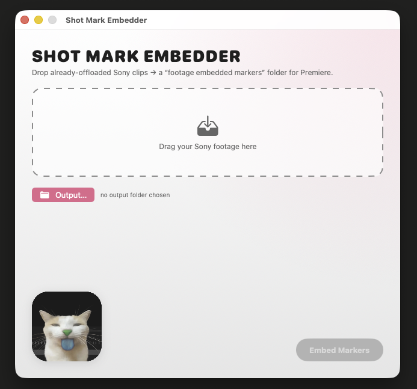
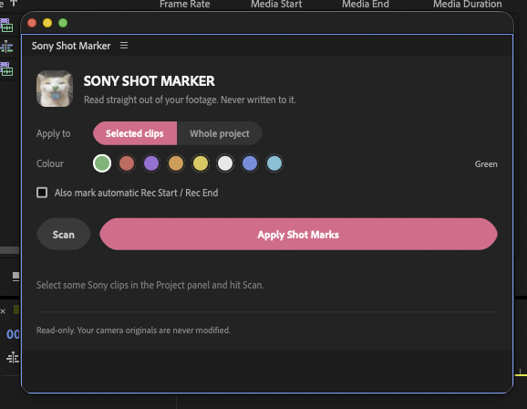
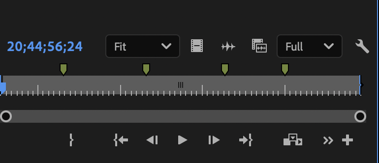
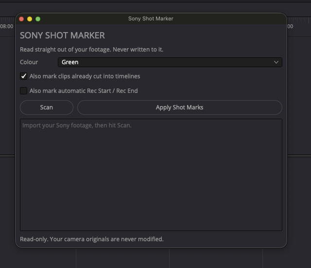
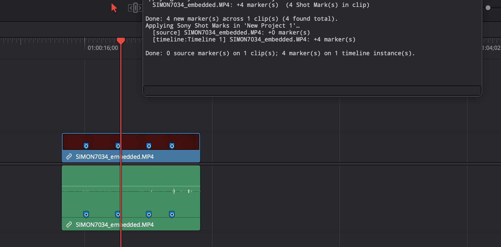

# Shot Mark Embedder

Your Sony can drop a frame-accurate marker while you're rolling. Hit C1 mid-take and it
flags the exact frame — the moment the dog finally sat, the take where the line landed. It's
one of the best features on the A7S III and the FX bodies and almost nobody uses it, because
the second you import that footage into Premiere or Resolve, the marks are gone. The NLEs
don't speak Sony's metadata, so the work you did on set evaporates.

This fixes that. Two ways, depending on what you care about.



## Pick one

**The Premiere panel** reads the marks straight out of your footage and adds them as clip
markers. Nothing is copied, nothing is written, your originals are untouched on disk. Select
your clips, hit a button, done. This is what you want if you don't want a second copy of
everything on your drives. → [`plugin/`](plugin/)

**The app** bakes the marks into a *copy* of each clip as standard Adobe XMP. Slower, uses
disk, but the marks then travel with the file — hand it to another editor on another machine
with no plugin installed and the markers are just there. → [Releases](https://github.com/lelanddutcher/SonyShotMarker/releases)

**The Resolve panel** does the same thing inside DaVinci Resolve. Resolve refuses to read
markers out of a media file no matter how they're embedded — that's a Resolve limitation,
not mine, and even Sony's own plugin can't import Shot Marks there — so this reads the
camera metadata itself and applies the marks through Resolve's API. → [`plugin/resolve/`](plugin/resolve/)

All three read the same marks the same way and put them in the same place. Use whichever
fits your workflow.

**Never done this before?** [**docs/GETTING_STARTED.md**](docs/GETTING_STARTED.md) walks
through the whole thing in plain English — setting up the camera button, installing, and
what to do when something doesn't work. No command line required.

## Why I built this instead of paying Sony

Sony does have an official answer — the Catalyst Prepare Plugin for Premiere. I tried it.

It puts a **giant watermark across your footage** unless you pay for Catalyst Prepare, which
runs $100+/year. So the "free" plugin is a trial nag with your dailies as the hostage. It's
a native C++ MediaCore plugin locked to a narrow band of Premiere versions (roughly 15.4 to
22.4) — update Premiere and it breaks, and it has been effectively frozen for years. And
Sony's own docs admit the Resolve version can't import Shot Marks at all.

For a feature that amounts to "read a number out of an XML document the camera already
wrote," that's a bad deal.

## Turning Shot Marks on

If you've never used them, this is the on-set half, and it takes one minute:

`MENU → Setup → Operation Customize → Custom Key/Dial Set`, pick a button — C1 or the
shutter button both work well — and assign **Add Shot Mark1**. Assign **Add Shot Mark2** to
another button if you want a second flavour.

Then while the camera is rolling, tap it. That's the whole workflow. `Shot Mark1` and
`Shot Mark2` are independent, so you can use them for two different meanings — keeper versus
cutaway, say. Everything here reads both.

## Premiere Pro

Install the panel ([instructions](plugin/)), select your Sony clips in the Project panel, and
hit **Apply Shot Marks**. Markers appear at the frames you marked, named and colour-coded,
with source timecode in the comment.

<div align="center">

<br><em>The panel. Pick a scope, pick a colour, Scan to look, Apply to commit.</em>
<br><br>

<br><em>Four C1 presses, read straight from the file.</em>
</div>

It's safe to run twice — it only adds what's missing, and everything it adds is one undo.

If you went the app route instead, just import the embedded copies; the markers are already
in them and Premiere picks them up with nothing installed. Import into a clean project or
bin, though — Premiere caches clip metadata by file path, so if you previously imported the
original it'll happily show you stale data and you'll think the tool is broken.

## DaVinci Resolve

```bash
plugin/install_resolve_macos.sh
```

```powershell
powershell -ExecutionPolicy Bypass -File plugin\install_resolve_windows.ps1
```

That's one file copied into Resolve's scripts folder — do it by hand if you prefer:

- macOS: `~/Library/Application Support/Blackmagic Design/DaVinci Resolve/Fusion/Scripts/Utility/`
- Windows: `%APPDATA%\Blackmagic Design\DaVinci Resolve\Support\Fusion\Scripts\Utility\`

Import your footage, then `Workspace ▸ Scripts ▸ SonyShotMarker`. A window opens with the
same controls as the Premiere panel — colour picker, scan-before-you-commit, and a toggle
for whether to mark clips already cut into timelines. That last one matters: Resolve doesn't
retroactively push source markers onto clips you've already edited in, so they have to be
marked directly.

It's idempotent, it's one file, and it needs nothing installed — no ffmpeg, no exiftool, no
pip packages. It runs in Resolve's built-in Python. If Fusion's UI toolkit isn't reachable
it falls back to running headless and printing to `Workspace ▸ Console`.

Two older Resolve scripts are still around and still supported —
[`tools/Resolve_ApplyShotMarks.py`](tools/Resolve_ApplyShotMarks.py) for a no-window,
mark-everything batch run, and [`tools/resolve_shotmarks.py`](tools/resolve_shotmarks.py)
for marking a single clip from the command line. The installer won't touch them if you've
got them. See [`plugin/resolve/`](plugin/resolve/) for when you'd want which.

<div align="center">

<br><em>Same idea, native Resolve window.</em>
<br><br>

<br><em>The same four marks, on the source clip and on the timeline instance.</em>
</div>

You don't need to run the embedder first for Resolve. The script reads the camera's marks
directly.

## Where the marks actually live

Short version: Sony writes Shot Marks as SMPTE KLV essence marks inside a `NonRealTimeMeta`
XML document, which lives both inside the `.MP4` and as the `Cxxxx M01.XML` sidecar. Each
mark is a label (`_ShotMark1` / `_ShotMark2`) and a frame count. The clip's start timecode is
packed BCD in a separate table.

The annoying part: on an A7S III that XML sits in a `meta` box **after** the video data. On
my 335 MB test clip it starts at byte 335,813,843. So anything that wants to read it either
loads the whole file — fine for one clip, fatal for a card offload — or walks the container
properly. Everything here walks it properly: the Premiere panel finds four marks in that
clip using 15 reads totalling 283 KB, which is 0.08% of the file, and never touches a byte
of the media payload.

Then:

- **Premiere panel:** hands the frame positions to Premiere's marker API. Nothing is written
  to your media at all.
- **The app:** writes the marks as Adobe Dynamic Media (`xmpDM`) XMP into the file's reserved
  `free` space *before* the media data, which is the only place Premiere actually looks. The
  media itself never moves, so there's no re-wrap and no re-encode.
- **Resolve:** hands the same frame positions to `MediaPoolItem.AddMarker()`.

The full reverse-engineering write-up — byte layout, the LTC decode, the KLV keys, and the
bug where XMP appended at EOF is readable by exiftool but invisible to Premiere — is in
[`docs/FINDINGS.md`](docs/FINDINGS.md).

## Cameras

Built and verified on the **A7S III** shooting XAVC-I / XAVC-S / XAVC-HS, up to 4K120. Sony
writes Shot Marks identically across its modern XAVC bodies, so the **FX3, FX30, FX6, A1 and
A7 IV** should all work — same `NonRealTimeMeta` document. I haven't personally tested every
one of them. If yours doesn't read correctly, open an issue with the clip's `M01.XML` and
I'll take a look.

The panel and the Resolve script read `.MP4`, `.MOV` and `.MXF`. The app's embedding targets
`.MP4` and `.MOV`.

## Build from source

```bash
git clone https://github.com/lelanddutcher/SonyShotMarker.git
cd SonyShotMarker
```

The Mac app is pure Swift — no Python, no ExifTool, no runtime dependencies:

```bash
cd app && swift run          # or: bash build_app.sh  ->  app/dist/Shot Mark Embedder.app
```

The Premiere panel is plain JavaScript, no build step:

```bash
node tests/js/test_shotmarks.js && node tests/js/test_clipmarks.js && node tests/js/test_panel.js
python3 plugin/package_plugin.py
```

The Python toolkit and the Resolve script need Python 3.8+ and nothing else:

```bash
python3 -m pytest -q tests
python3 tools/sony_shotmark.py /path/to/CLIP.MP4
```

### Windows

The Windows app port lives in [`windows/`](windows/) and is still **experimental** — CI
builds and smoke-tests it on `windows-latest`, and it shares the exact same pure-Python
marker engine as the Mac app, but it hasn't had a full validation pass on real footage on a
Windows machine yet.

The Premiere panel is a different story: it's the same JavaScript on both platforms, so the
only genuinely platform-specific part is path handling — drive letters, backslashes, UNC
shares, spaces. That's isolated in one file with its own tests, and the full plugin suite
runs on `windows-latest` in CI.

```powershell
py -3.12 -m venv .venv-win
.\.venv-win\Scripts\Activate.ps1
python -m pip install -r requirements-windows.txt
python -m pytest -q tests
powershell -ExecutionPolicy Bypass -File windows\build_windows.ps1
```

## Before you delete any originals

The panel and the Resolve script only read your files, so there's nothing to worry about
there. The **app** is different — it writes copies, and I want to be straight with you about
what that means.

It's about as careful as a tool can be: it only ever writes copies, it reuses reserved empty
space already in the container, and it never moves or re-encodes your actual video and audio.
In testing it's been clean. But any tool that writes to a media file carries some nonzero
risk of corruption. It's very low here by design. It is not zero.

So do the obvious thing:

1. Run the embed. Leave your originals exactly where they are.
2. Import the embedded copies and actually watch them. Confirm they play start to finish,
   the audio's intact, the markers are right.
3. Only then, and only with your normal 3-2-1 backups still in place, consider clearing the
   originals.

Never delete your only copy of anything because a piece of free software said "Done." This
is also not an offload tool — do your validated, checksummed card copy first with Hedge,
Silverstack, [OpenLoupe](https://github.com/lelanddutcher/OpenLoupe), `rsync -c`, whatever
you trust. This assumes the footage is already safely on disk.

## Disclaimer

No warranty. Use at your own risk. Shot Mark Embedder is provided "as is," without warranty
of any kind, express or implied. By using it you accept that you are solely responsible for
your footage and your backups. **The author (Leland Dutcher) is not liable for any data loss,
file corruption, lost footage, missed marks, or any other damages** arising from the use of
this software, in any amount, under any circumstances. Always keep verified backups of your
original camera files and do not delete them until you have independently confirmed the
embedded copies are correct and intact. This software touches your media files; if that
makes you nervous, don't use it on anything you can't afford to lose. See the
[MIT License](LICENSE) for the full legal terms.

## License

[MIT](LICENSE) © 2026 Leland Dutcher. Do whatever you want with it; just don't blame me if
it breaks.

---

<sub>Built because losing on-set marks at import is dumb. Made with a tongue-out cat and a
lot of reverse-engineering.</sub>
